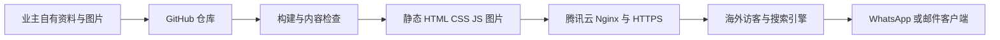

# 技术架构与选型

版本 v0.2；2026-11-03；状态：P1 已采用静态栈并验证。Astro 7.4.5、TypeScript 6.0.3、@astrojs/check 0.9.12、@types/node 24.19.2 已锁定；Node 24.22.1、pnpm 11.25.0 已实际构建。Astro 官方当前要求 Node ≥22.23.4，本环境满足；TypeScript 最新 7.0.2 不在检查器 ^5／^6 peer 范围，故锁定 6.0.3。来源见[文献](research/SOURCES.md)。

## 推荐栈

| 层 | 选择 | 与需求的关系 |
| --- | --- | --- |
| 页面框架 | Astro 静态生成 | 多页面展示、可抓取 HTML，运行时负担小 |
| 语言 | TypeScript 严格检查 | 约束案例、图片、语言和联系方式数据 |
| 样式 | 原生 CSS、设计变量、逻辑属性 | 接近参考布局，方便 RTL；不引入额外 UI 框架 |
| 内容 | 仓库内 JSON／TypeScript 数据；案例和文章可用 Astro 内容集合及 schema | 集中配置，构建时校验，适合少修改 |
| 交互 | 原生模块脚本 | 菜单、语言卡片与可选图片浏览，按需加载 |
| 图片 | P1 本地空白槽／宽高／alt；P2 计划构建时优化 | 真实素材到位后再增加响应式派生与压缩，不将规划视为已实现 |
| 构建 | Node 24.22.1＋pnpm 11.25.0＋pnpm-lock.yaml | 环境提供 pnpm，没有 npm；仅用于开发和构建 |
| 生产服务 | 腾讯云 Linux＋Nginx | 提供静态文件和正确的路由、缓存、HTTPS |
| 业务后端／数据库 | 第一版无 | 咨询在 WhatsApp／邮件完成，不存用户提交 |
| 质量检查 | 类型／内容校验、静态产物链接检查、关键浏览器路径和性能检查 | 验证真实需求，不写仅重复模板的测试 |

依据：[Astro 渲染](https://docs.astro.build/en/guides/on-demand-rendering/)、[内容集合](https://docs.astro.build/en/guides/content-collections/)、[图片](https://docs.astro.build/en/guides/images/)。业务受众看到普通网页，不需要知道构建工具。

## 方案比较

| 方案 | 优点 | 本项目的成本与取舍 |
| --- | --- | --- |
| WordPress＋Elementor，接近同行 | 可视化管理成熟，动态表单插件丰富 | 业主不需要后台；仍要维护 PHP、数据库、插件更新及可能的插件／翻译订阅 |
| Astro 静态站，推荐 | 静态 HTML、集中内容、少 JS，部署和迁移简单 | 内容修改要改仓库并构建；本项目接受该方式 |
| Next.js 静态导出或服务端渲染 | React 生态与后续复杂应用扩展方便 | 目前没有账号、实时数据或复杂应用状态，暂不承担这些能力的额外复杂度 |
| 手写 HTML 多页 | 工具少，启动快 | 多语言案例增加后容易出现重复模板与 SEO 不一致；选择构建时组件更可控 |

选择 Astro 不限制页面视觉，可重建相近布局；不需要保留同行 WordPress 的后台结构。框架本身不保证 SEO 排名，内容、可抓取性与加载表现仍需验证。

## 数据流



GitHub 与生产服务器分离，提交不自动等于上线。首版手动发布已验证的构建产物；自动部署可后续增加，不在仓库中明文写服务器凭据。生产主机不必安装 Node。

## 建议工程组织

P1 已实现下列结构。文章只有数据契约和布局，无路由；图片槽位支持 public/media 自有文件，当前没有真实图片。Astro 图片处理、响应式派生图和最终裁切留待 P2 素材就绪后实施及验证，不能把当前 Media 组件说成已经自动生成 WebP／AVIF。

```text
src/
  components/    Header LanguageCard CaseCard Gallery ContactActions Footer
  layouts/       SiteLayout 与 SEO 头部
  pages/         index.astro 和各语言页面
  data/          site.ts cases.ts types.ts articles.ts
  i18n/          en.ts 主要页面英文文案 routes.ts 语言状态与案例映射
  scripts/       原生菜单 语言 图片浏览交互
  styles/        global.css 设计变量与响应式逻辑样式
public/          favicon 字体许可证；自有图片后续放 media/
scripts/         内容与链接检查 构建检查
docs/            当前需求及设计记录
```

## 数据契约

稳定业务 ID 与语言 slug 分离。Case 代表定制案例或能力示例，不要求固定 SKU、库存和公开价格。

| 对象 | 必要字段 | 约束 |
| --- | --- | --- |
| Site | brandName、canonicalOrigin、defaultLocale、localeStates、contacts | 未填的品牌和正式域名不能通过正式发布检查；预览允许占位 |
| MaterialCategory | id、localizedTitle、localizedDescription | id 仅 fiberglass、stainless-steel；展示名本地化 |
| Case | id、material、status、locales、images、featured | id 跨语言稳定；状态 preview／draft／published；预览插槽正式模式排除 |
| CaseLocale | locale、slug、title、summary、body、seoTitle、seoDescription、reviewStatus | 一种语言一份正文；reviewStatus 决定能否启用 |
| CaseSpec | sizeNote、finish、application、customizationNotes | 不明确的参数省略，不造数据；尺寸以可定制描述为主 |
| Image | source、alt、width、height、rights、credit | P1 为英文 alt；非空 source 必须是本地文件且有授权记录；多语言 alt／焦点与响应式派生图 P2／P3 扩展 |
| Contacts | whatsappDigits、email、facebookUrl、instagramUrl | 空值不生成可点击账号；正式版本至少一个真实主要渠道 |

所有用户文本在模板中按普通内容转义，案例内容不直接渲染未审查任意 HTML。联系方式模板使用 URL API／encodeURIComponent 构造，不能拼出错误参数或把未编码的 & 混入消息。网站不把点击误记为成功发送。

## 核心组件行为

- Header：桌面导航与移动菜单；当前页状态；键盘和焦点处理。
- LanguageCard：三语名称、已发布状态、等价页路由；不得用 href="#" 表示未上线语言。
- MaterialList：服务端生成两类入口和列表；简单规模不需要客户端搜索服务。
- CaseGallery：有说明的缩略图和主图；放大浏览若实施，支持 Esc 关闭和焦点返回；JS 失效仍有主图。
- ContactActions：按案例自动携带标题和正式 URL；空联系方式在预览中显示待配置说明，正式发布前补齐。
- ProofSection：有真实工艺图、资质或评价才展示；否则省略，保留同行相近留白与层次但不造证明。

## 主要风险与处理

图片空缺会限制视觉比对和性能结果，先完成插槽和规范；最终素材需重新检查裁切与性能。第三方社交平台可能在部分地区受限，核心网页和邮箱不依赖社交 SDK。单机部署没有高可用承诺；通过版本回滚、日志、证书续期和资源告警满足初期规模。后续若增加表单或后台，必须重新评估服务端、数据、运维和需求范围。
