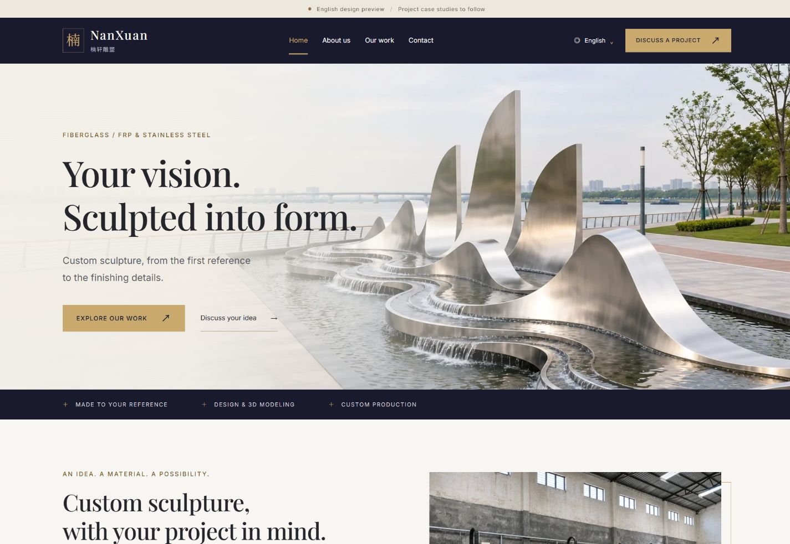

# v0.3 素材版本地验收

公司标后续补充（v0.3.1）：见 [品牌 QA](brand/README.md)。当前上级 build-report.json 已更新为 17 HTML／859 本地链接及资源；下方 723 链接与图片体积属于新增品牌图之前的素材基线。原始截图保留，最新公司标截图在 brand 目录。

2026-11-05（Asia/Shanghai）；Windows，Node 24.22.1、pnpm 11.25.0、Astro 7.4.5、sharp 0.35.5。Codex in-app browser（未暴露版本），模拟视口 360／390×844、768／1440×1000 CSS px；不是四台真实设备。检查对象为当前分支的静态预览 `http://127.0.0.1:4321/en/`，对应本次 v0.3 提交，可从 Git 历史查看。

## 实际结果

| 检查 | 结果／证据 |
| --- | --- |
| `pnpm check` | Astro 0 error／warning／hint；内容、咨询、文档检查通过 |
| `pnpm build` | 17 HTML、723 本地链接／资源（含 srcset），单 H1、独立元信息；[构建报告](../build-report.json) |
| 预览 SEO | 全部 HTML noindex，无正式 canonical／hreflang／sitemap |
| `pnpm check:http` | 16 页面入口 200/noindex、5 个预期 404；[HTTP 报告](../http-results.json) |
| 四档布局 | 7 类页面×4 视口，28 项均无 document 横向溢出、单 H1、已加载图无解码错误；[布局 JSON](layout-results.json) |
| 四档交互 | 47 项通过：语言、手机菜单、Esc／焦点、大图／方向键／前后切换、8 图总览／4 图分类、未发布案例展开／详情／刷新；[交互 JSON](interaction-results.json) |
| `pnpm check:media` | 10 母版、35 派生 WebP 尺寸／解码通过，36 次本地 HTTP 200；[图片报告](media-report.json) |
| 正式发布门槛 | `pnpm check:release` 返回 1，明确列出正式 HTTPS origin 缺失、无审核通过真实案例；符合本阶段未发布范围 |

全部 10 张编辑成品均经视觉查看。凤凰第一版新增了原图未展示的完整支架，已重做为原始裁切构图；最终母版才参与检查。桌面画廊方形框 contain 保留主体，手机大图高度／操作按钮可见；主视觉桌面和手机分别组织图片与正文。修正深色咨询区邮件按钮的文字对比度、品牌字号和预览卡片滚动留白后重新构建，并复测全部 28 布局。

47 项交互包含键盘操作。桌面未发布案例的自动指针点击曾因滚动位置／粘性页头超时，先检查实际链接并用 Enter 成功打开／刷新；补充滚动留白后，最终桌面指针点击也已成功到达详情，单独追加复测记录。没有发送 WhatsApp 消息或邮件。

## 体积与加载边界

35 张 WebP 最大单文件 284,548B。首页正常正文 6 张唯一图片使用最大回退文件合计 **1,120,212B**；关于页 283,074B、总览 1,654,136B、玻璃钢 837,248B、不锈钢 816,888B。计算排除了隐藏大图 dialog 的重复引用，是文件体积上限汇总，不是浏览器首次加载流量。

首页 HTML 23,785B、全部 CSS 30,740B、woff2 字体 95,436B。包含内联交互的每页最高 JS 3,480B／gzip 937B，外链脚本 0。手机截图与 DOM 记录验证 srcset 选用了较小派生文件。图片使用已声明宽高，首图 eager、其他 lazy。完整数据与本地未限速响应时间见图片报告；回环响应时间不代表海外网络、LCP 或现场 CWV。

## 可查看截图

| 状态 | 文件 |
| --- | --- |
| 首页桌面 | [1440px](screenshots/home-1440.jpg) |
| 首页手机 | [390px](screenshots/home-390.jpg) |
| 企业资料 | [1440px](screenshots/about-1440.jpg) |
| 真实素材画廊 | [1440px](screenshots/gallery-1440.jpg) |
| 手机大图浏览 | [390px](screenshots/viewer-390.jpg) |

## 复现与尚未验收

在仓库运行 `pnpm install --frozen-lockfile`、`pnpm check`、`pnpm build`，再 `pnpm preview`；另开终端执行 `pnpm check:http` 和 `pnpm check:media`。浏览器按上述四档检查首页、关于、总览、两类材料、详情和联系；使用 Enter、方向键、Esc、Tab 测试关键控件。关闭终端或 Ctrl+C 停止预览；检查结束已停止本轮临时服务，按启动说明可重新运行。

未进行：真实手机／独立浏览器兼容性、禁用 JS 的完整浏览器体验、移动限速实验室 CWV、海外区域访问、正式域名 DNS／TLS、真实会话／收件、正式项目审核、多语言完整内容／RTL。已有图片不等于真实案例首发：8 个详情仍为明确 preview，正式模式排除。未购买资源、未向托管平台发布、未合并 PR。
