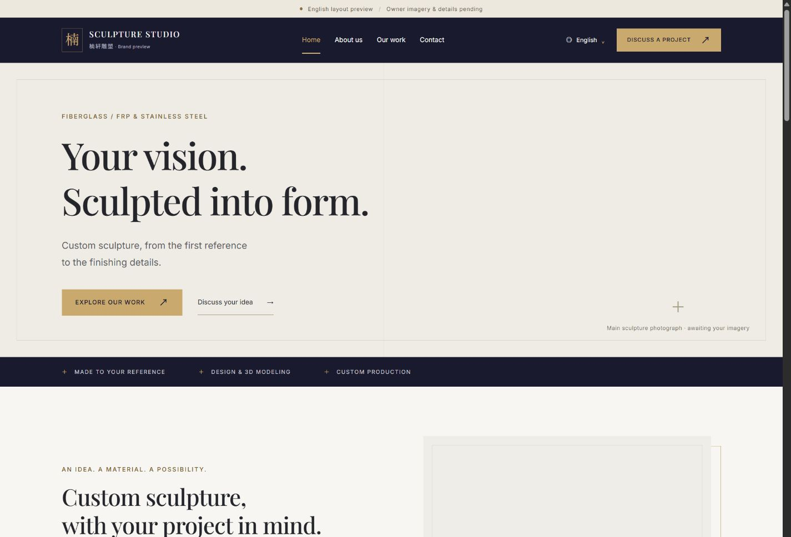

# P1 本地检查证据

版本 v0.2；2026-11-03（Asia/Shanghai）；状态：本地静态预览已检查，正式环境未检查。

## 环境与方法

Windows，Node 24.22.1，pnpm 11.25.0，Astro 7.4.5。浏览器为 Codex in-app browser，版本接口未暴露。`pnpm preview` 提供构建后的 http://127.0.0.1:4321/en/。视口为 360／390×844 和 768／1440×1000 CSS px，模拟尺寸；不是四台真实设备。

- [构建产物报告](build-report.json)：17 HTML、527 个本地链接和资源；独立标题／描述、单 H1、noindex、无生产 sitemap；内联脚本计入每页 gzip JS 878B。
- [HTTP 报告](http-results.json)：根入口和 15 个英文页面 200；错误地址、虚构案例、两种未发布语言与 sitemap 返回 404。
- [布局测量](layout-results.json)：7 类页面×4 视口，共 28 项，没有 document 横向溢出。
- [四档交互](responsive-interactions.json)：30 项通过，语言／菜单键盘开合、Esc／焦点、列表／详情路径及直接刷新、图片浏览切换。
- [补充交互](interaction-results.json)：手机正反 Tab 循环、语言关闭按钮焦点、玻璃钢详情路径和图片浏览等 9 项通过。

截图是本项目的占位预览，同行照片、页面截图和完整文案不进入仓库。参考站浏览器观察见[参考分析](../research/REFERENCE_ANALYSIS.md)。

## 可查看截图

| 页面／状态 | 桌面 | 手机 |
| --- | --- | --- |
| 首页 | [1440px](screenshots/home-1440.jpg) | [390px](screenshots/home-390.jpg) |
| 案例总览 | [1440px](screenshots/cases-1440.jpg) | 以布局 JSON 记录 |
| 玻璃钢详情 | [1440px](screenshots/detail-1440.jpg) | [390px](screenshots/detail-390.jpg) |
| 语言卡片 | [1440px](screenshots/languages-1440.jpg) | [390px](screenshots/languages-390.jpg) |
| 手机菜单 | — | [390px](screenshots/menu-390.jpg) |
| 图片浏览 | — | [390px](screenshots/gallery-390.jpg) |

## 复现与边界

先 `pnpm check`、`pnpm build`，再运行 `pnpm preview`；另开终端 `pnpm check:http`。浏览器打开对应路径，按记录的四种视口检查；用 Tab／Enter／Esc 操作语言和菜单，材料页点击案例并刷新，详情按 Enter 打开缩略图，再按方向键／Esc。

资料门槛 `pnpm check:release` 当前应返回非零；不是产品故障。已用独立 Node 进程内存注入缺图和误发布状态验证拒绝逻辑，没有改动内容文件。

截图捕获接口在快速切换视口时曾返回不可捕获，重新读取页面状态后用已提供的 screenshot API 成功保存关键图；这不影响布局与交互测量。未做像素差分或声称像素还原。空白素材环境未作为正式性能验收；没有浏览器禁用 JS、真实移动设备、真实账号、海外网络、生产域名／TLS 或完整 RTL 验收。
